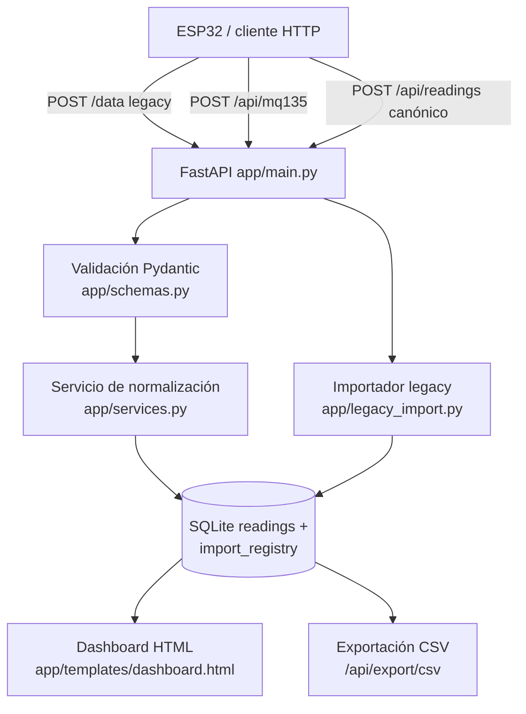

# Air Quality Fusion API

API unificada de calidad del aire que consolida dos proyectos previos (Flask + CSV y FastAPI + SQLite) en un solo backend FastAPI: ingesta por tres endpoints compatibles, persistencia SQLite, dashboard HTML, exportación CSV e importación automática de datos legacy.

[](https://github.com/bi0punk/air-quality/actions/workflows/ci.yml)
[](https://www.python.org/)
[](LICENSE)

## Contenido

- [Características](#características)
- [Arquitectura](#arquitectura)
- [Stack](#stack)
- [Estructura del repositorio](#estructura-del-repositorio)
- [Instalación](#instalación)
- [Uso](#uso)
- [Configuración](#configuración)
- [Tests / CI](#tests--ci)
- [Roadmap](#roadmap)
- [Licencia](#licencia)

## Características

- Unificación del modelo de datos en una sola tabla `readings` (`device_id`, `ao`, `do_value`, `voltage`, `quality_label`, `source`, `ts`).
- Compatibilidad hacia atrás: acepta el endpoint legacy `POST /data` (Flask) y `POST /api/mq135`, además del canónico `POST /api/readings`.
- Persistencia SQLite (WAL, índices) con exportación CSV on-demand.
- Importador automático de datos antiguos (`datos_calidad_aire.csv` y `mq135.db`), idempotente vía `import_registry` (~13 k filas en <2 s).
- Dashboard HTML (Jinja2): última lectura, estado de alerta, histórico de AO, tabla de últimas lecturas y resumen por dispositivo.
- Hardening básico: validaciones Pydantic v2, host configurable, CORS sin credenciales, logging estructurado y `lifespan` de FastAPI.

## Arquitectura



En el arranque se intenta importar automáticamente `legacy_inputs/datos_calidad_aire.csv` y `legacy_inputs/mq135.db` (idempotente).

## Stack

- **Lenguaje**: Python 3.12+
- **Web**: FastAPI + Uvicorn + Jinja2 (dashboard)
- **DB**: SQLite (WAL, índices)
- **Validación**: Pydantic v2
- **Datos**: pandas (importación legacy CSV/SQLite)
- **Calidad**: ruff (lint), pytest

## Estructura del repositorio

```
air-quality/
├── app/
│   ├── __init__.py
│   ├── config.py           # Configuración por variables de entorno
│   ├── db.py
│   ├── legacy_import.py
│   ├── main.py             # Aplicación FastAPI
│   ├── schemas.py          # Modelos Pydantic
│   ├── services.py         # Normalización, stats, CSV
│   ├── static/
│   └── templates/
│       └── dashboard.html
├── tests/                  # smoke, schemas, services, legacy_import
├── legacy_inputs/          # datos_calidad_aire.csv, mq135.db
├── import_legacy.py        # Importación manual
├── requirements.txt
├── run.sh
└── .github/workflows/ci.yml
```

## Instalación

```bash
python3 -m venv .venv
source .venv/bin/activate
pip install -r requirements.txt
```

## Uso

```bash
./run.sh
```

Disponible en:

- Dashboard: `http://127.0.0.1:8000/dashboard`
- Salud: `http://127.0.0.1:8000/health`
- Info: `http://127.0.0.1:8000/api/info`

Endpoints de ingesta:

```bash
# Legacy Flask
curl -X POST http://127.0.0.1:8000/data \
  -H 'Content-Type: application/json' \
  -d '{"valor_analogico": 333, "voltaje": 0.27, "calidad_aire": "Buena"}'

# Compatibilidad MQ135
curl -X POST http://127.0.0.1:8000/api/mq135 \
  -H 'Content-Type: application/json' \
  -d '{"device_id": "mq135-uno-1", "ao": 512, "do": true}'

# Endpoint unificado recomendado
curl -X POST http://127.0.0.1:8000/api/readings \
  -H 'Content-Type: application/json' \
  -d '{"device_id": "sensor-lab-01", "ao": 421, "do_value": false, "voltage": 0.33, "quality_label": "Aceptable", "source": "manual"}'
```

Consulta:

```bash
curl 'http://127.0.0.1:8000/api/readings?limit=20'
curl 'http://127.0.0.1:8000/api/readings?device_id=mq135-uno-1&limit=10'
curl 'http://127.0.0.1:8000/api/readings/latest'
curl 'http://127.0.0.1:8000/api/stats?window=20'
curl -OJ 'http://127.0.0.1:8000/api/export/csv?limit=10000'
```

Importación manual:

```bash
python3 import_legacy.py --csv ./legacy_inputs/datos_calidad_aire.csv --sqlite ./legacy_inputs/mq135.db
```

## Configuración

Variables de entorno (definidas en `app/config.py`):

| Variable | Default | Descripción |
|---|---|---|
| `AIR_QUALITY_DB_PATH` | `./data/air_quality.db` | Ruta de la base SQLite |
| `AIR_QUALITY_DEFAULT_DEVICE_ID` | `mq135-default` | Dispositivo por defecto |
| `AIR_QUALITY_AO_ALERT_THRESHOLD` | `650` | Umbral de alerta para AO |
| `AIR_QUALITY_IMPORT_ON_STARTUP` | `1` | Importación legacy en arranque (`0` para desactivar) |
| `AIR_QUALITY_HOST` | `0.0.0.0` | Host del servidor |
| `AIR_QUALITY_PORT` | `8000` | Puerto del servidor |

## Tests / CI

```bash
pytest -q
```

La suite usa una DB efímera por test (`AIR_QUALITY_DB_PATH` en `tmp_path`) y desactiva la importación legacy (`AIR_QUALITY_IMPORT_ON_STARTUP=0`). Cubre endpoints smoke (health, ingesta unificada/legacy, listado, latest, stats, export CSV, dashboard), servicios (umbrales, normalización, insert/fetch, stats, CSV), schemas (alias, fuentes, rangos) e importación legacy idempotente. Cobertura aproximada: ~92 % del paquete `app/`.

CI: GitHub Actions (`.github/workflows/ci.yml`) sobre Python 3.12: **lint** (`ruff check .`) y **test** (`pytest -q`).

## Roadmap

- [x] Unificación de endpoints legacy + canónico
- [x] Importador idempotente de datos antiguos
- [x] Dashboard con resumen y alertas
- [ ] Autenticación para endpoints de ingesta
- [ ] Retención de datos y particionado lógico
- [ ] Alertas por Telegram/Email si AO supera umbral
- [ ] WebSocket/SSE para tiempo real
- [ ] Dockerización con volumen persistente
- [ ] Calibración por dispositivo y conversión AO a ppm

Nota técnica: el valor `AO` del MQ-135 no equivale a una medida ambiental certificada sin calibración; el proyecto lo trata como señal relativa para tendencias y alertas.

## Licencia

MIT — ver [LICENSE](LICENSE).